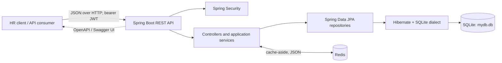
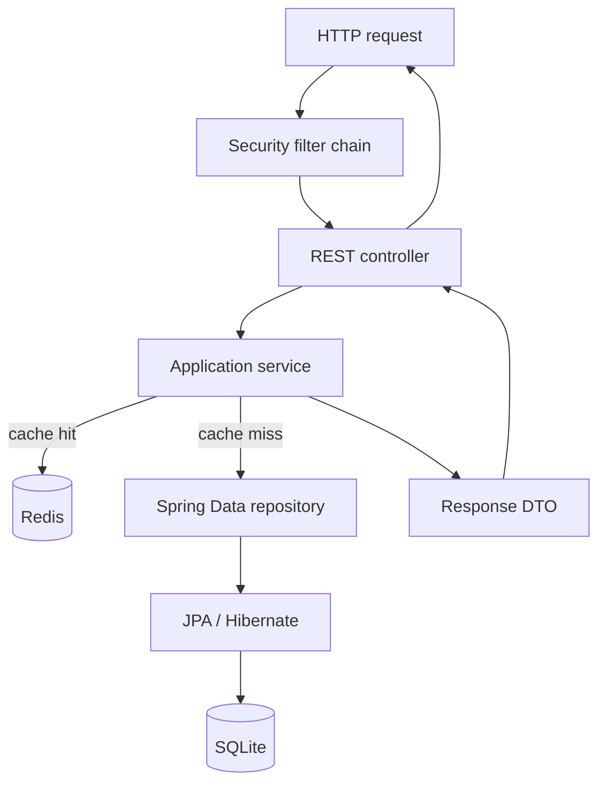
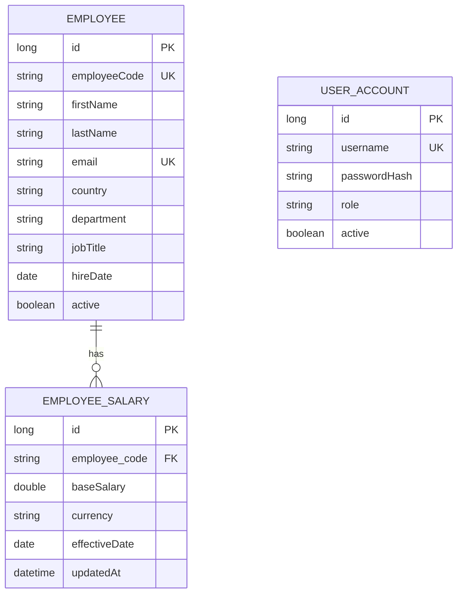

# Salary Management Application Architecture

## 1. Purpose and scope

Salary Management is a Java 25 / Spring Boot REST API for maintaining employee records and salary data, authenticating HR users, and returning workforce and salary analytics. It uses SQLite for persistence. The repository contains the backend; the Angular frontend mentioned in the project README is an external client and is not part of this application.

This document describes the implementation in `src/main`, including the public API, security boundary, persistence model, startup behavior, and the main request flows.

## 2. System context



The backend listens on port `8080` by default. Clients use `/api` routes for authentication, employee and salary operations, analytics, and sample-data seeding. OpenAPI is served at `/v3/api-docs`, with Swagger UI at `/swagger-ui/index.html`.

## 3. Runtime structure

The application is a single Spring Boot process organized as a conventional layered application under `com.acme.hr`:

| Layer / package | Responsibility |
|---|---|
| `SalaryManagementApplication` | Boots Spring and component scanning. |
| `controller` | HTTP routing and request/response mapping for auth, employees, analytics, and sample data. |
| `service` | Authentication, employee and salary operations, account lookup, analytics, and seeding coordination. |
| `repository` | Spring Data JPA access to employees, salaries, and user accounts. |
| `entity` | Persistent JPA models: `Employee`, `EmployeeSalary`, and `UserAccount`. |
| `dto` | API-specific request and response records; entities are not the primary API response contract. |
| `exception` | Maps missing resources to `404` and invalid arguments to `400` using `ProblemDetail`. |
| `config` | Security/JWT/CORS, OpenAPI metadata, bootstrap accounts, and sample-data generation. |



The explicit REST controllers are:

| Controller | Base path | Routes |
|---|---|---|
| `AuthController` | `/api/auth` | `POST /login` |
| `EmployeeController` | `/api/employees` | `GET /`, `GET /{id}`, `POST /`, `PUT /{id}`, `PUT /{id}/salary` |
| `AnalyticsController` | `/api/analytics` | `GET /summary`, `GET /by-country`, `GET /by-department` |
| `SeedController` | `/api` | `POST /seed` |

The employee collection route returns a Spring `Page` and supports zero-based paging, sorting, a case-insensitive search over employee code/name/email, and exact case-insensitive country, department, and job-title filters plus an active-status filter.

### Redis cache

Redis is a cache-aside layer for service-level employee detail, employee search page, and analytics reads. A cache hit returns the JSON-deserialized DTO/page result without querying SQLite; a miss runs the normal service/repository path and stores the result. SQLite remains authoritative. Keys are namespaced by cache and employee search keys include all search/filter arguments and page/sort values. Values use a concrete Jackson JSON type per cache (including the generic item type for analytics lists), avoiding polymorphic `Object` deserialization. The `salary-management:v2:` key prefix prevents older cache entries written with a different serializer from being read after upgrade.

| Cache | Contents | TTL |
|---|---|---:|
| `employeeDetails` | Employee detail DTO, including latest salary | 10 minutes |
| `employeeSearch` | Paginated employee search results | 2 minutes |
| `analyticsSummary` | Total/active headcount and currency salary statistics | 5 minutes |
| `analyticsByCountry` | Country-grouped headcount and salary statistics | 5 minutes |
| `analyticsByDepartment` | Department-grouped headcount and salary statistics | 5 minutes |

Employee create/update, salary update, and seeding evict the employee and analytics caches after successful method execution. `RepositoryCacheEvictionHandler` also invalidates them for employee or salary writes through Spring Data REST repository routes. Redis cache access errors are logged and treated as cache failures so the request proceeds through the database-backed service path; this makes Redis optional for availability, but means cache invalidation also cannot take effect during a Redis outage. Cache misses and Redis failures therefore fall back to SQLite.

## 4. Main request flows

### Authentication and authorization

1. At startup, `UserAccountBootstrap` validates configured bootstrap credentials and creates missing HRManager and ADMIN accounts. Passwords are BCrypt-encoded. Existing matching usernames are kept; a username already assigned a different role causes startup to fail.
2. A client submits username and password to the public `POST /api/auth/login` endpoint.
3. `AuthService` delegates credential verification to Spring Security's `AuthenticationManager`, then signs an HS256 JWT containing its issuer, subject, issue/expiry times, and role.
4. For protected requests, the resource-server filter validates the bearer JWT and maps its `roles` claim to Spring `ROLE_...` authorities.
5. The security chain is stateless. Login and Swagger/OpenAPI routes are public; all other routes require `HRManager`. An authenticated ADMIN account can log in but is not authorized to use those routes.

Invalid login credentials return `401`; authenticated callers without the required role receive `403`. CORS accepts configured exact origins, selected API methods, and `Authorization`, `Content-Type`, and `Accept` headers; cookie credentials are disabled.

### Employee and salary operations

`EmployeeController` delegates to `EmployeeService`, which validates required employee fields, applies search/filter specifications, loads employee records, and maps entities to response DTOs. The employee table enforces unique employee codes and email addresses. IDs are database-generated.

Salary changes are sent to `PUT /api/employees/{id}/salary`. The implementation finds the employee's salary rows ordered by effective date and updates the first (most recent) row, or creates one if none exists. Consequently, despite the effective-date model and historical-sounding API description, repeated updates currently overwrite the latest row rather than always appending a salary-history row. Employee detail responses include the latest salary if one exists.

An unknown employee raises `ResourceNotFoundException` and maps to `404`. Invalid service-level employee or salary input maps to `400`. Authentication failures are converted to `401` by `AuthController`.

### Analytics

`AnalyticsService` loads employees and salary records, selects each employee's latest salary by `effectiveDate`, and returns:

- summary total and active employee counts with salary statistics by currency;
- employee counts, active counts, and salary statistics grouped by country;
- the same measures grouped by department.

Salary totals and averages are calculated independently per currency; no currency conversion is performed. Employees without salary data still contribute to headcount but not salary statistics. Null country or department values are grouped under `Unspecified`.

### Sample data

`POST /api/seed` invokes `SeedService` and `SeedDataConfig`. When the employee table is empty, the generator creates 10,000 employee/salary pairs in batches of 500, using a fixed random seed for generated choices. Hire and salary effective dates are relative to the current date, so the complete dataset is not identical across runs on different dates. It skips generation if employees already exist. This is an explicit API operation, not automatic startup seeding; it is subject to the same HRManager authorization as other non-public routes.

## 5. Data and persistence



`EmployeeSalary.employee_code` references the unique `Employee.employeeCode`; the association is many-to-one from salary to employee. `UserAccount` is an independent authentication table. All three models use generated numeric IDs. Hibernate is configured with `ddl-auto: update`; the SQLite database file is `mydb.db` in the process working directory, using `org.hibernate.community.dialect.SQLiteDialect`.

Repositories extend Spring Data JPA: `EmployeeRepository` also supports JPA specifications, `SalaryRepository` provides effective-date ordered queries, and `UserAccountRepository` looks up accounts by username. The build includes Spring Data REST, but the intended/documented API surface is the explicit controllers above; repository routes, if exposed by the configured Spring Data REST auto-configuration, are not represented in the generated OpenAPI specification (`springdoc.enable-data-rest` is disabled).

## 6. Configuration and operational dependencies

| Setting | Default / source | Purpose |
|---|---|---|
| `spring.datasource.url` | `jdbc:sqlite:mydb.db` | SQLite connection and file location. |
| `spring.jpa.hibernate.ddl-auto` | `update` | Updates schema at startup. |
| `APP_BOOTSTRAP_HR_MANAGER_USERNAME` / `..._PASSWORD` | Required | Initial HRManager account. |
| `APP_BOOTSTRAP_ADMIN_USERNAME` / `..._PASSWORD` | Required | Initial ADMIN account. |
| `APP_SECURITY_JWT_SECRET` | Required; minimum 32 bytes | HS256 signing and verification key. |
| `app.security.jwt.expiration` | `PT1H` | Access-token lifetime. |
| `APP_CORS_ALLOWED_ORIGINS` | `http://localhost:4200` | Comma-separated exact browser origins; wildcard and empty configurations are rejected. |
| `REDIS_HOST` | `localhost` | Redis cache host. |
| `REDIS_PORT` | `6379` | Redis cache port. |
| `REDIS_PASSWORD` | Empty | Optional Redis authentication password. |

Redis connection and command timeouts are set to two seconds. The runtime dependencies include Spring MVC/Web, Spring Security OAuth2 Resource Server, Spring Data JPA and Data REST, Spring Cache and Spring Data Redis, SQLite JDBC, Hibernate's community dialects, and SpringDoc OpenAPI. Gradle configures Java 25 and JUnit Platform tests.

## 7. Source map

```text
src/main/java/com/acme/hr/
  SalaryManagementApplication.java
  config/       SecurityConfig, CacheConfig, RepositoryCacheEvictionHandler,
                OpenApiConfig, UserAccountBootstrap, SeedDataConfig
  controller/   AuthController, EmployeeController, AnalyticsController, SeedController
  cache/        JSON-serializable employee search page snapshot for Redis
  dto/          Request and response records for login, employees, salaries, and analytics
  entity/       Employee, EmployeeSalary, UserAccount
  exception/    ApiExceptionHandler, ResourceNotFoundException
  repository/   EmployeeRepository, SalaryRepository, UserAccountRepository
  service/      AuthService, EmployeeService, EmployeeSearchCacheService,
                AnalyticsService, SeedService, UserAccountDetailsService
src/main/resources/
  application.yaml
  static/       (no application-owned static assets)
  templates/    (no application-owned server-rendered templates)
```

There is no server-rendered UI in the repository; the application is API-first. The README documents local startup, environment configuration, API examples, and test execution.
